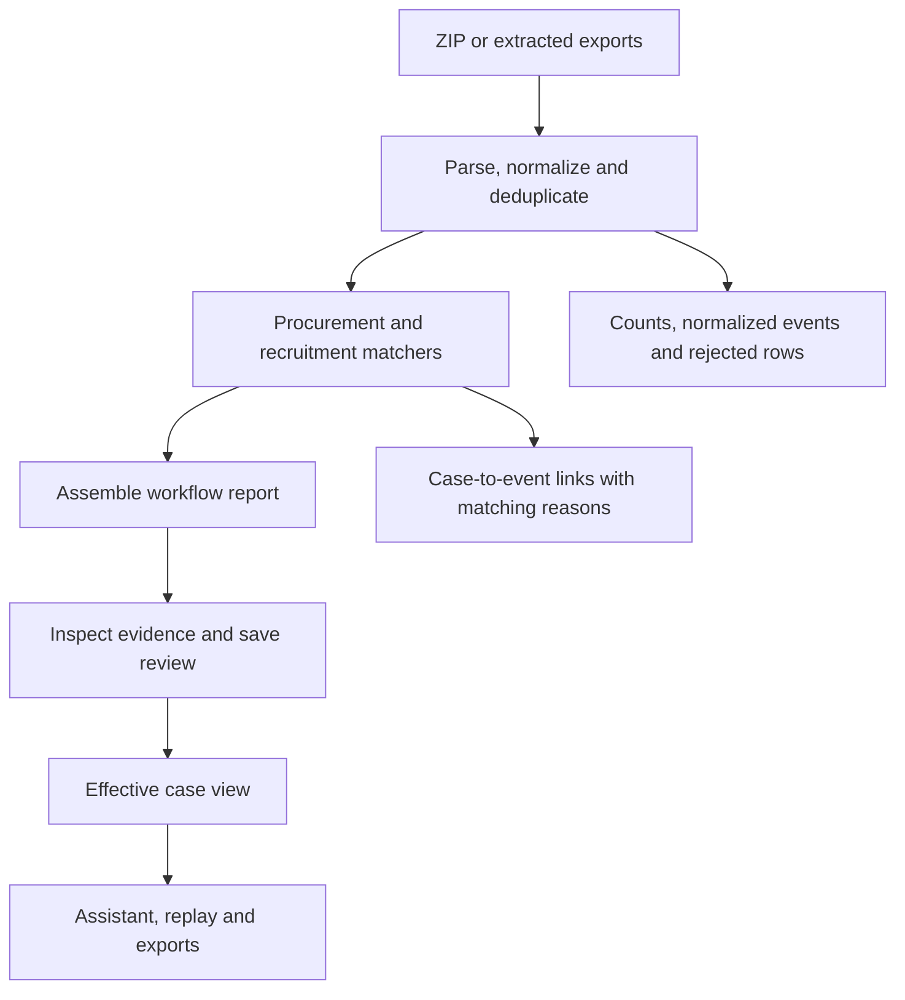

# Architecture and data structures

The prototype follows laptop procurement and recruitment screening. A procurement case begins with a Teams request thread. A recruitment case groups appointments with the same named candidate and role. Both produce the same evidence and review contract.

The browser and Node.js use the same source adapters and matching rules. The browser reads supported ZIP contents in memory and draws the report locally. The CLI also accepts a directory and writes the intermediate files. The hosted site begins with a separately redacted report so reviewers can try it without importing anything.

## From exports to evidence

| Stage | Rule and practical limit |
| --- | --- |
| Parse | Recognize Outlook messages and calendar events, Teams messages and channel posts, and screen logs by their export paths. Record invalid rows with their original location. |
| Normalize | Convert supported timestamps to UTC and preserve whether they indicate a scheduled start or a recorded event. Show times in Sri Lanka time in the app. Deduplicate email by internet message ID, calendar events by event identity and start, and Teams messages by message identity and scope when available. Keep all known source locations for a duplicate. |
| Identify a case | Start from a Teams channel message with the laptop request pattern. Replies must point to that request and belong to the same channel. Quotes and later approvals in the thread provide evidence for those stages. |
| Link an order | Require a matching vendor and product, a matching recipient, and an earlier approval. If exactly one case qualifies, attach the vendor confirmation. A first-name-only recipient match is labeled inferred. Ambiguous candidates are left unlinked. |
| Link receipt | Accept a receipt report in the original request thread or a matching Teams message from a uniquely identified recipient after their order. The report captures what someone said. Delivery time remains unknown. |
| Identify recruitment work | Start from a non-canceled appointment whose title identifies both candidate and role. Group on the normalized pair. Keep appointment times as scheduled starts. |
| Link a reported screening | A Teams message explicitly reports a conversation. Require a compatible name, the same mailbox and exactly one candidate case with a screening slot during the preceding six hours. An alias match remains inferred. The role wording in these messages frequently refers to the client, so it is not an identity key. |
| Link an offer reply | Require an explicit acceptance or decline in an email from the named candidate, matching role and a prior scheduled client interview. Leave ambiguous responses outside the case. |
| Assemble | A step is observed when a matching record directly supports it, inferred when its links rely on weaker matching, and missing when no record qualifies. Unsupported activities remain in the normalized output. |

Procurement has five checkpoints and recruitment has four. The stage strip follows process order. Replay sorts the surviving records by their timestamps and retains the source's timestamp meaning. The exports cover activities across the entire team, including many screen logs that alone cannot establish a case or outcome.

## File shapes

| Structure | Key fields |
| --- | --- |
| Normalized event | `id`, `source`, `at`, `timeKind`, `text`, `origin`, `origins[]` and available provider fields such as `providerId` and `replyToId` |
| Rejected row | `origin`, `reason` |
| Evidence link | `eventId`, `caseId`, `stage`, `rule` |
| Report | `version`, `dataset`, `process`, `cases[]`, `stats`. A root report may include additional reports in `processes[]`. |
| Case | `id`, `label`, procurement details and `steps[]` |
| Step | `id`, `label`, `status`, `evidence[]` |
| Evidence | `id`, `source`, `at`, `timeKind`, `text`, `origin`, `reason`. Order records include `checks[]` with the matching fields and their outcomes. |
| Review | Decision, note and ordered unlink/restore actions scoped to the dataset, process, case and stage. The report projection applies the latest action per link. JSON export includes the original process report and applied review history. |

## Question routing and review

The assistant receives the current effective process, case and stage. A device language model can choose a registered tool by returning a single validated intent. A multinomial naïve Bayes classifier handles routing when that model is unavailable. The six tools build a case chronology, list review gaps, rank cases for review, compute workflow coverage, retrieve source records or prepare a team brief. The brief counts distinct cases with an ordered change of source between adjacent stages and suggests questions to check with the team. Retrieval weights matching terms by their rarity within the case. Each substantive case finding carries the actual case, stage and record identifiers used to construct it. A gap points to the empty stage. The user can open the citation or choose a correction in the evidence sheet.

The language model only receives the question and previous question. Record searches and response construction run locally, and an answer cannot modify a case. Model selection is optional and bounded by a timeout. The automated suite checks routing, abstention on attendance, valid record references, correction propagation and the model fallback.

## Validation and privacy

- Check that a reply from a different thread cannot approve a request, a late approval cannot explain an earlier order, and competing matches leave an order unlinked. Inspect at least one linked order and one missing stage in the report.
- The prototype recognizes procurement message templates in this dataset and extracts vendor names from the records. Different templates, missing records, and overlapping cases reduce coverage. Screen titles indicate activity context and are insufficient to establish a procurement stage.
- The public build includes a redacted report. Raw exports and full CLI output stay local. Anyone exporting an imported report from the browser should treat it like the source data.
- Browser review state is saved on the current device. It is suitable for a prototype walkthrough. A shared workflow would need an audit history and authenticated reviewer identities.

For production, queue source ingestion by organization and cursor, store events and evidence links separately, and preserve the rule version beside each result. Keep source access scoped by role. Any future model-assisted match should return candidate event IDs with reasons and pass validation before it becomes a reviewable inference.
