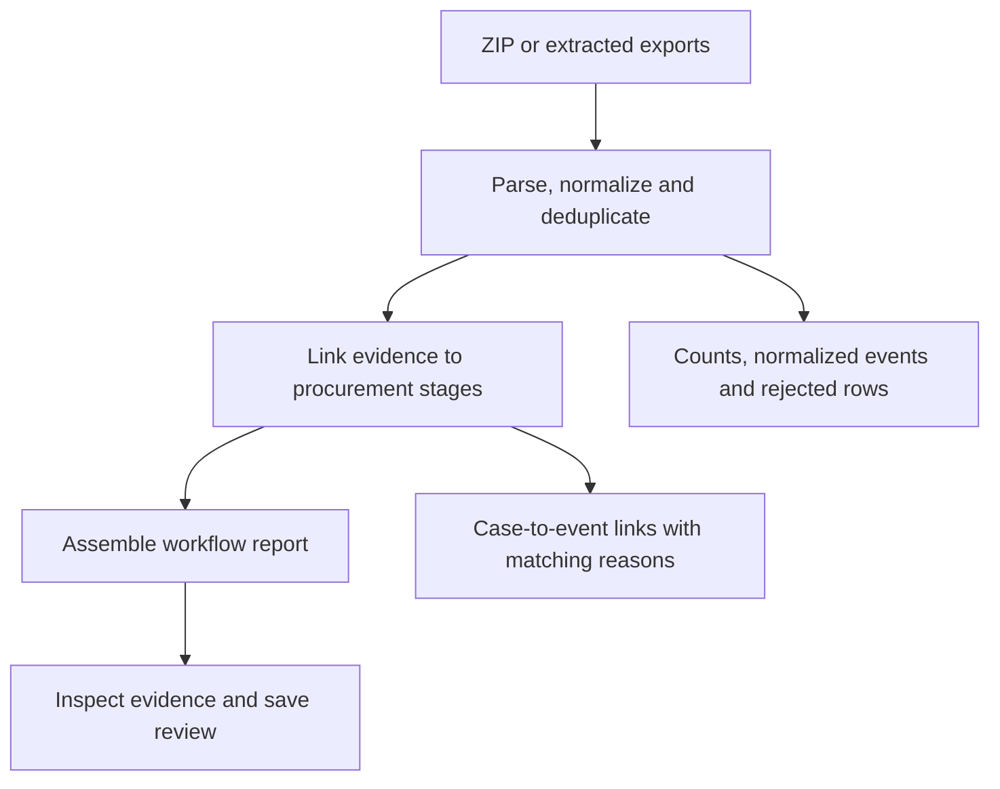

# Architecture and data structures

The prototype follows one process, laptop procurement. A Teams request thread gives it a strong case boundary, while vendor emails and receipt messages test whether events from different sources can be connected without merging unrelated activity.

The browser and Node.js use the same source adapters and matching rules. The browser reads supported ZIP contents in memory and draws the report locally. The CLI also accepts a directory and writes the intermediate files. The hosted site begins with a separately redacted report so reviewers can try it without importing anything.

## From exports to evidence

| Stage | Rule and practical limit |
| --- | --- |
| Parse | Recognize Outlook messages and calendar events, Teams messages and channel posts, and screen logs by their export paths. Record invalid rows with their original location. |
| Normalize | Convert supported timestamps to UTC and preserve whether they indicate a scheduled start or a recorded event. Show times in Sri Lanka time in the app. Deduplicate email by internet message ID, calendar events by event identity and start, and Teams messages by message identity and scope when available. Keep all known source locations for a duplicate. |
| Identify a case | Start from a Teams channel message with the laptop request pattern. Replies must point to that request and belong to the same channel. Quotes and later approvals in the thread provide evidence for those stages. |
| Link an order | Require a matching vendor and product, a matching recipient, and an earlier approval. If exactly one case qualifies, attach the vendor confirmation. A first-name-only recipient match is labeled inferred. Ambiguous candidates are left unlinked. |
| Link receipt | Accept a receipt report in the original request thread or a matching Teams message from a uniquely identified recipient after their order. The report captures what someone said. Delivery time remains unknown. |
| Assemble | A step is observed when a matching record directly supports it, inferred when its links rely on weaker matching, and missing when no record qualifies. Unsupported activities remain in the normalized output. |

The five stages form a process template. Times on individual evidence items reflect source records, and the stage order describes the workflow. A large unlinked count is expected because these exports cover an entire team and this prototype investigates one process.

## File shapes

| Structure | Key fields |
| --- | --- |
| Normalized event | `id`, `source`, `at`, `timeKind`, `text`, `origin`, `origins[]` and available provider fields such as `providerId` and `replyToId` |
| Rejected row | `origin`, `reason` |
| Evidence link | `eventId`, `caseId`, `stage`, `rule` |
| Report | `version`, `dataset`, `process`, `cases[]`, `stats` |
| Case | `id`, `label`, procurement details and `steps[]` |
| Step | `id`, `label`, `status`, `evidence[]` |
| Evidence | `id`, `source`, `at`, `timeKind`, `text`, `origin`, `reason` |
| Review | Decision and optional note keyed to the dataset, case and step. Kept separately from the original evidence. |

## Validation and privacy

- Check that a reply from a different thread cannot approve a request, a late approval cannot explain an earlier order, and competing matches leave an order unlinked. Inspect at least one linked order and one missing stage in the report.
- The prototype recognizes patterns and vendors present in this dataset. Different templates, missing records, and overlapping cases reduce coverage. Screen titles indicate activity context and are insufficient to establish a procurement stage.
- The public build includes a redacted report. Raw exports and full CLI output stay local. Anyone exporting an imported report from the browser should treat it like the source data.
- Browser review state is saved on the current device. It is suitable for a prototype walkthrough. A shared workflow would need an audit history and authenticated reviewer identities.

For production, queue source ingestion by organization and cursor, store events and evidence links separately, and preserve the rule version beside each result. Keep source access scoped by role. Any future model-assisted match should return candidate event IDs with reasons and pass validation before it becomes a reviewable inference.
